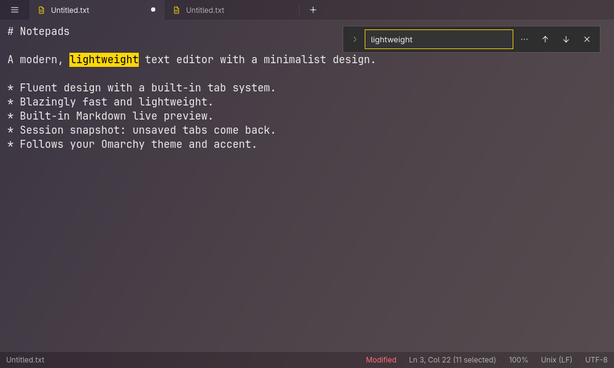

# Notepads



A modern, lightweight text editor with a minimalist design, for
[Omarchy](https://omarchy.org). Its look and feel follow
[Notepads](https://github.com/0x7c13/Notepads) for Windows by Jackie Liu: a
translucent window over Hyprland's blur, tabs, a quiet status bar, a floating
find box, and a settings pane. It's written from scratch in C++ and Qt Quick
and follows your Omarchy theme, accent, rounding, and language.

- Tabs, with session snapshot: unsaved tabs come back after you close the app
- Keeps each file's encoding (UTF-8, UTF-8 BOM, UTF-16 LE/BE, ISO-8859-1) and
  line ending (LF, CRLF, CR); change either from the status bar
- Find and replace, with match case, whole word, and regular expressions
  (`$1` or `\1` in replacements)
- Markdown live preview side by side (Alt+P)
- Hebrew reads naturally: every paragraph gets its own direction, and Hebrew
  letters use a bundled proportional face (a subset of Noto Sans Hebrew)
  while code and English keep your monospace font. Documents with Hebrew
  always wrap, since right-to-left lines align to the text's right edge
- Line numbers, on the side each line starts from: English on the left,
  Hebrew on the right
- Word spacing from 20% to 300% of a normal space
- A global shortcut that opens a new window, tiled beside the others like a
  terminal, Super+Alt+N by default, changeable in Settings > Advanced
- Word wrap, line highlight, font, tab width, and tint opacity in settings
- Saves atomically: writes beside the file, then renames over it
- Open and save dialogs through the XDG desktop portal

## Install

```sh
bin/install
```

This builds the package with `makepkg` and installs it, so Notepads appears in
the app launcher (Super + Space). Open files from a terminal with
`notepads file.txt …`.

## Shortcuts

| Keys | Action |
| --- | --- |
| Ctrl+N / Ctrl+T | New tab |
| Ctrl+O | Open files |
| Ctrl+S | Save |
| Ctrl+Shift+S | Save as |
| Ctrl+Alt+S | Save all |
| Ctrl+W | Close tab |
| Ctrl+Tab / Ctrl+Shift+Tab | Next / previous tab |
| Ctrl+1 … Ctrl+9 | Go to tab (9 is the last) |
| Ctrl+F / Ctrl+H | Find / replace |
| F3 / Shift+F3 | Next / previous match |
| Ctrl+Z / Ctrl+Shift+Z | Undo / redo |
| Ctrl+D | Duplicate line |
| Ctrl+E | Search the web for the selection |
| Ctrl+= / Ctrl+- / Ctrl+0 | Zoom in / out / reset (also Ctrl+wheel) |
| Alt+Z | Toggle word wrap |
| Alt+P | Toggle Markdown preview |
| Ctrl+, | Settings |
| F1 | Show shortcuts |
| Ctrl+Q | Quit |

A text editor needs the plain letter keys and Space for typing, so Notepads
uses Ctrl+Q to quit and F1 for the shortcut overlay instead of Omarchy's usual
Q and ?.

## Develop

```sh
bin/build      # build/notepads
bin/test       # unit tests, offscreen
```

The global shortcut is a Hyprland binding that Notepads writes to
`~/.config/hypr/notepads.lua`. The first time, it appends one line to
`~/.config/hypr/hyprland.lua` to load that file (after saving a
`hyprland.lua.bak.<time>` copy); it never edits your other bindings.

Settings live in `~/.config/notepads/notepads.conf`, and the session snapshot
in `~/.local/state/notepads/session.json` (readable only by you). When two
windows are open, the first keeps the session and the other asks before
discarding unsaved changes.
